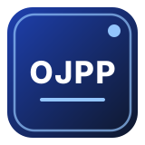

<div align="center">



# MA Open Justice & Public Prosperity Integration Observatory

### From open data to public trust — interoperability and metadata layer across six access-to-justice observatories.

[](LICENSE)  [](https://github.com/bsdkijc-dev/ma-open-justice-public-prosperity/actions/workflows/ci.yml)

[Documentation](architecture/) · [Repository](https://github.com/bsdkijc-dev/ma-open-justice-public-prosperity)

</div>

---

**Tagline:** From Open Data to Public Trust. From Public Trust to Public Value.  
**Program Period:** 2027–2030  
**Execution Mode:** `SAFE MODE` (No bulk publication, no institutional contact, no restricted data merging)

> **Institutional Disclaimer:** This is an independent research and policy initiative. It is **not** an official Mahkamah Agung RI program unless formally authorized through the appropriate institutional process. Nothing in this repository implies institutional endorsement, access rights, or official authorization.

## Overview

The MA Open Justice & Public Prosperity Integration Observatory connects six independent access-to-justice research projects through a shared metadata, provenance, and interoperability layer—without transferring project ownership, authorization, or publication rights:

1. **P01 — Indonesia Open Justice Observatory (IOJO):** Transparency, accessibility, efficiency, accountability, and verifiability of public judicial information.
2. **P02 — Justice for UMKM Observatory:** Access to justice, legal security, resilience, and economic prospects of micro and small enterprises.
3. **P03 — Justice for Rural Communities Observatory (JRC):** Geographic, economic, social, and institutional barriers in rural and remote communities.
4. **P04 — Indonesia Labour Justice Observatory (ILJO):** Workers' access to justice, industrial relations (PHI) disputes, procedural barriers, remedies, and enforcement.
5. **P05 — People's Legal Knowledge Observatory (PLKO):** Availability, comprehensibility, reliability, and practical usefulness of public legal information.
6. **P06 — Justice for the Last Mile:** Design and evaluation of practical interventions for underserved populations (`NOT STARTED`).

## Repository Structure

- `governance/` — Program charter, integration/data governance, privacy, ethics, publication policy, risk register, independence disclaimer.
- `architecture/` — System architecture, common data model (D01–D16), interoperability, source provenance, integration contracts, project dependency map.
- `projects/` — Six-project registry (`project-registry.json`, `project-registry.csv`) and project interface notes (no unauthorized repo copies).
- `shared/` — Common data dictionary (18 required variable attributes), JSON schemas, 5-family indicator framework, taxonomies (`P1`–`P5`, missing-value semantics).
- `data/` — Tiered storage (`raw/`, `interim/`, `integrated/`, `synthetic/`, `approved-public/`). Only `P5` synthetic data is populated in Phase 1.
- `analysis/` — Specifications for Analytical Modules 01–08 across 5 indicator families.
- `policy/` — Policy Intelligence Engine schema, 90-day roadmap, and proposal register templates.
- `reports/` — Integration Feasibility Report and audit outputs.
- `tests/` — Automated `unittest` + `jsonschema` validation suite.

## Setup & Validation Guide

```bash
python3 -m venv .venv
source .venv/bin/activate
pip install -r requirements.txt
python3 -m unittest discover -s tests -v
```

---

<div align="center">

**MA Open Justice & Public Prosperity Integration Observatory**

[github.com/bsdkijc-dev/ma-open-justice-public-prosperity](https://github.com/bsdkijc-dev/ma-open-justice-public-prosperity)

</div>
